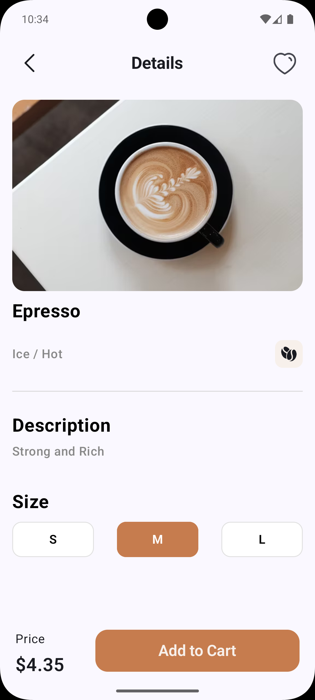
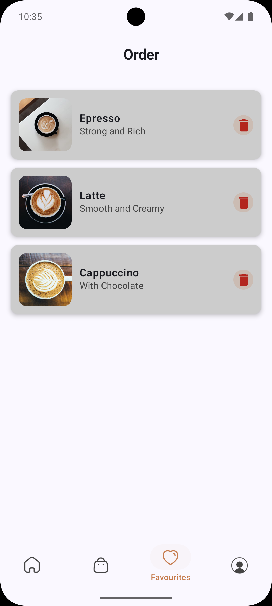
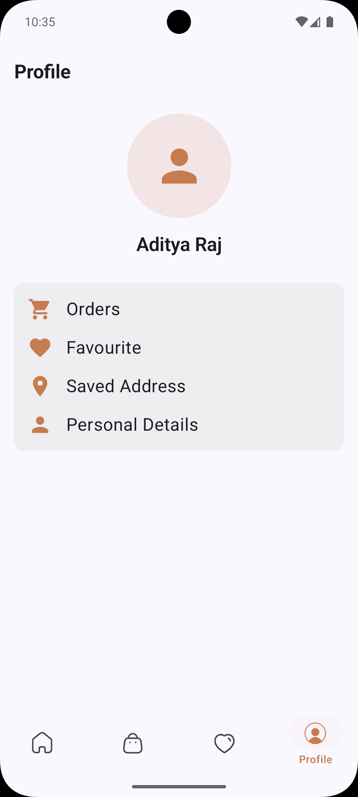

# ☕ Coffee Shop App

A coffee ordering Android application UI built using Kotlin and Jetpack Compose. The app includes Home, Cart, Wishlist, and Profile screens with a clean and user-friendly interface.

Developed as a learning project by following the Neat Roots YouTube tutorial.

## 📱 Screenshots

<table>
  <tr>
    <td align="center">
      <b>Welcome</b> 
      
    </td>
    <td align="center">
      <b>Home</b> 
      
    </td>
    <td align="center">
      <b>Product Details</b> 
      
    </td>
  </tr>
  <tr>
    <td align="center">
      <b>Cart</b> 
      
    </td>
    <td align="center">
      <b>Wishlist</b> 
      
    </td>
    <td align="center">
      <b>Profile</b> 
      
    </td>
  </tr>
</table>

## ✨ Features
- Home Screen
- Product Details
- Cart Screen
- Wishlist Screen
- Profile Screen
- Modern user interface

## 🛠 Tech Stack
- Kotlin
- Jetpack Compose
- Android Studio

## 📝 Note
This project currently focuses on UI development. Backend integration, database, and actual ordering functionality are not implemented.

## 🙌 Credits
Tutorial: [Neat Roots - YouTube](https://youtu.be/0CPqFDo4rwU)
