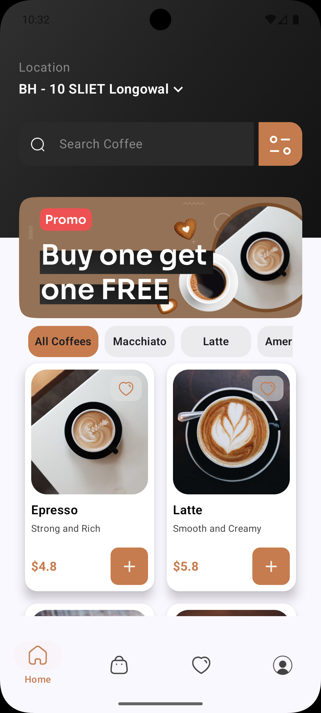
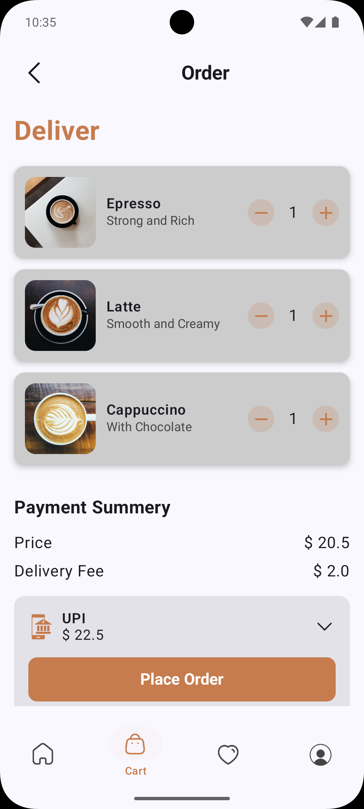

# ☕ Coffee Shop App

A coffee ordering Android application UI built using Kotlin and Jetpack Compose. The app includes Home, Cart, Wishlist, and Profile screens with a clean and user-friendly interface.

Developed as a learning project by following the Neat Roots YouTube tutorial.

## 📱 Screenshots

### Home Screen

### Cart Screen

### Wishlist Screen

### Profile Screen

## ✨ Features
- Home Screen
- Product Details
- Cart Screen
- Wishlist Screen
- Profile Screen
- Modern user interface

## 🛠 Tech Stack
- Kotlin
- Jetpack Compose
- Android Studio

## 📝 Note
This project currently focuses on UI development. Backend integration, database, and actual ordering functionality are not implemented.

## 🙌 Credits
Tutorial: [Neat Roots - YouTube](https://youtu.be/0CPqFDo4rwU)
